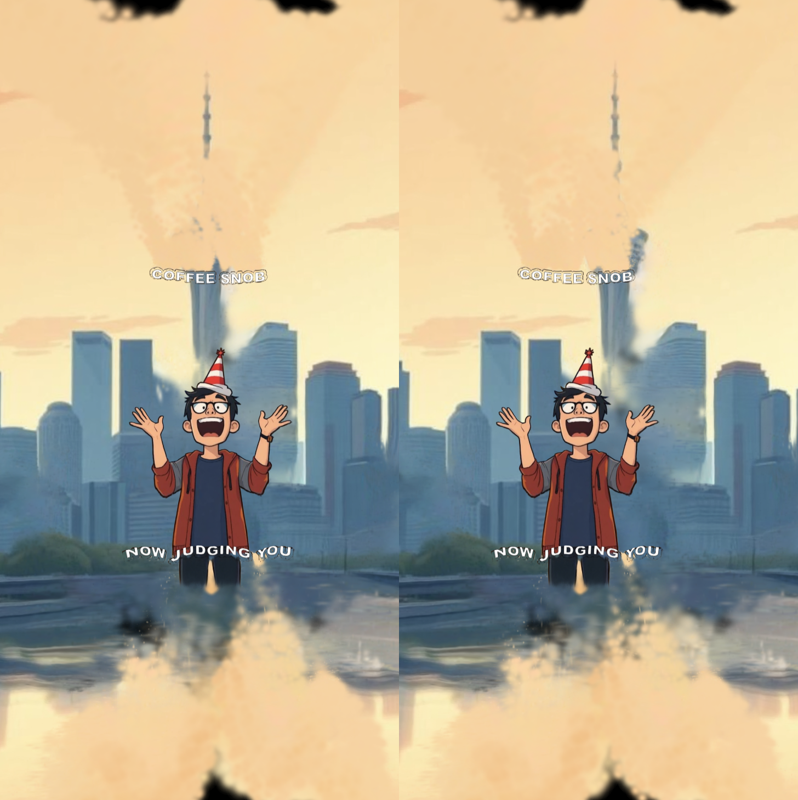

# AutoSplat

A free macOS research demo that turns a single photo into an interactive 3D Gaussian splat scene, on your Mac.

**Built on Apple's SHARP model.** All 3D generation comes from Apple's [SHARP](https://github.com/apple/ml-sharp) (*Sharp Monocular View Synthesis in Less Than a Second*, Mescheder et al., [arXiv:2512.10685](https://arxiv.org/abs/2512.10685)). AutoSplat runs a community Core ML conversion of it ([pearsonkyle/Sharp-coreml](https://huggingface.co/pearsonkyle/Sharp-coreml)). What AutoSplat adds is the Mac app around the model:
- drag-and-drop and batch conversion;
- a real-time viewer;
- head-tracked parallax from the front camera;
- stereo output (side-by-side, over/under, anaglyph, parallax barrier);
- point-cloud export.

## Research use only

The SHARP weights are licensed under the **Apple Machine Learning Research Model License Agreement**. It allows non-commercial scientific research only, and excludes commercial exploitation, product development and use in any commercial product or service. Clicking **Download Model** downloads those weights, and you must use them under that licence's terms. Read the full text in [`licenses/APPLE_ML_RESEARCH_MODEL_LICENSE.txt`](licenses/APPLE_ML_RESEARCH_MODEL_LICENSE.txt).

Apple Machine Learning Research Model is licensed under the Apple Machine Learning Research Model License Agreement. AutoSplat is an independent project, not affiliated with or endorsed by Apple.

## How it works

1. **Download the model** (about 2.67 GB, once), or select a local Core ML model.
2. **Drop a photo** (JPG, PNG, TIFF, BMP or HEIC).
3. **Generate.** SHARP predicts the scene's 3D Gaussians on the Neural Engine and GPU, and the viewer opens automatically.

Your photos never leave your Mac. The only network request is the one-time model download from Hugging Face.

**Exports:** OBJ, USDZ and PLY are coloured point clouds made from the splat centres. They don't preserve the full Gaussian representation.

## Requirements

- macOS 14 or later.
- An Apple Silicon Mac is recommended for Neural Engine inference.
- To build from source: Xcode. Open `AutoSplat.xcodeproj` and run the `AutoSplat` scheme.

## Licence

- **AutoSplat's own code:** [MIT](LICENSE).
- **The SHARP model and its Core ML conversion:** the Apple research licence above.
- **Bundled third-party code:** Spark (MIT) and three.js (MIT). See [THIRD_PARTY_NOTICES.md](THIRD_PARTY_NOTICES.md).

Made by [Simone Leonelli](https://www.w230.net).
